

<picture>
  <source media="(prefers-color-scheme: dark)" srcset="assets/heroi-escuro.svg">
  <source media="(prefers-color-scheme: light)" srcset="assets/heroi-claro.svg">
  
</picture>

<a href="https://italocunhadev.site/"><picture><source media="(prefers-color-scheme: dark)" srcset="assets/tecla-portfolio-escuro.svg"><source media="(prefers-color-scheme: light)" srcset="assets/tecla-portfolio-claro.svg">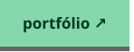</picture></a>
<a href="mailto:italocisarpinheiro@gmail.com"><picture><source media="(prefers-color-scheme: dark)" srcset="assets/tecla-email-escuro.svg"><source media="(prefers-color-scheme: light)" srcset="assets/tecla-email-claro.svg">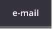</picture></a>
<a href="https://www.linkedin.com/in/italo-cunha-028baa356/"><picture><source media="(prefers-color-scheme: dark)" srcset="assets/tecla-linkedin-escuro.svg"><source media="(prefers-color-scheme: light)" srcset="assets/tecla-linkedin-claro.svg">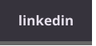</picture></a>
<a href="https://www.instagram.com/_italocunha_/"><picture><source media="(prefers-color-scheme: dark)" srcset="assets/tecla-instagram-escuro.svg"><source media="(prefers-color-scheme: light)" srcset="assets/tecla-instagram-claro.svg">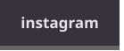</picture></a>

 

### Eu sou o Italo.

Faço **jogos** desde os 10 anos, escrevo **back-end**, construo sistemas **desktop** e desenho **interfaces** que mudam de cor com o wallpaper. Aprendo do jeito mais lento e mais certo: *refazendo até entender*.

- 🟩 criei a **[Mosaic](#a-mosaic)** — um desktop, uma loja e uma biblioteca de interface para Linux, todos com a cara do seu wallpaper
- 🟪 fiz um sistema de atendimentos completo em **Delphi**, com usuário, permissão, log e anexos
- 🟦 estou aprendendo **Rust** — e o próximo back-end vai ser em **Go**
- ⬜ Linux desde 2021, Arch desde 2022, CachyOS + Hyprland hoje — Windows, nunca mais

> Este README é tema claro **e** escuro: no GitHub escuro ele vem no tema **Mosaic**; no claro, no tema **Papel** — igual ao meu [portfólio](https://italocunhadev.site/).

 

## O que eu sei fazer

<picture>
  <source media="(prefers-color-scheme: dark)" srcset="assets/sei-fazer-escuro.svg">
  <source media="(prefers-color-scheme: light)" srcset="assets/sei-fazer-claro.svg">
  
</picture>

 

## A Mosaic

Uma identidade visual que virou ecossistema. O **Matugen** tira uma paleta do wallpaper e tudo se pinta com ela. As regras são poucas e rígidas: **calma, rápida e legível** — blocos chapados, teclas que afundam, um campo de pontos atrás de tudo e a onda de pixels em toda troca de tela.

<table>
  <tr>
    <td width="33%" valign="top">
       
      <strong><a href="https://github.com/amendoa657/mosaicOS">Mosaic OS</a></strong> 
      Um shell em Quickshell para o Hyprland: ilha líquida, dock de vidro e temas que trocam as cores <em>e</em> as formas. 
      <code>QML</code> <code>Hyprland</code> <code>Matugen</code>
    </td>
    <td width="33%" valign="top">
       
      <strong><a href="https://github.com/amendoa657/mosaicStore">Mosaic Store</a></strong> 
      Uma loja de pacotes para o Arch: busca local em SQLite FTS5, AUR, PKGBUILD e o build ao vivo, sem abrir terminal. 
      <code>Python</code> <code>Flask</code> <code>pywebview</code>
    </td>
    <td width="33%" valign="top">
       
      <strong><a href="https://github.com/amendoa657/mosaicStore/tree/main/mosaic-ui">Mosaic UI</a></strong> 
      A identidade virou biblioteca: sem build, sem dependência, sem framework. Um Web Worker desenha todos os pixels. 
      <code>HTML</code> <code>CSS</code> <code>JS</code>
    </td>
  </tr>
</table>

 

## Agora compilando

<picture>
  <source media="(prefers-color-scheme: dark)" srcset="assets/agora-escuro.svg">
  <source media="(prefers-color-scheme: light)" srcset="assets/agora-claro.svg">
  
</picture>

 

## Projetos

<a href="https://github.com/amendoa657/hwAtendimentoDelphi"><picture><source media="(prefers-color-scheme: dark)" srcset="assets/projetos/hw-atendimento-escuro.svg"><source media="(prefers-color-scheme: light)" srcset="assets/projetos/hw-atendimento-claro.svg">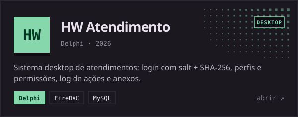</picture></a>
<a href="https://github.com/amendoa657/indieSquad"><picture><source media="(prefers-color-scheme: dark)" srcset="assets/projetos/indiesquad-escuro.svg"><source media="(prefers-color-scheme: light)" srcset="assets/projetos/indiesquad-claro.svg">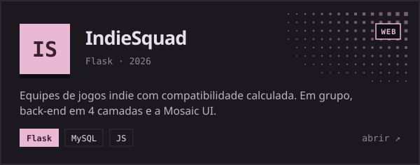</picture></a>
 
<a href="https://github.com/amendoa657/ApiAtendimento"><picture><source media="(prefers-color-scheme: dark)" srcset="assets/projetos/api-atendimento-escuro.svg"><source media="(prefers-color-scheme: light)" srcset="assets/projetos/api-atendimento-claro.svg">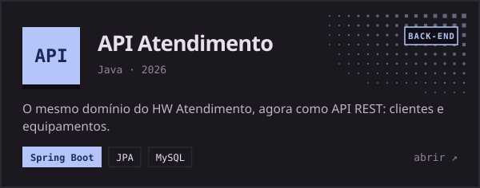</picture></a>
<a href="https://github.com/amendoa657/tuxAssist"><picture><source media="(prefers-color-scheme: dark)" srcset="assets/projetos/tuxassist-escuro.svg"><source media="(prefers-color-scheme: light)" srcset="assets/projetos/tuxassist-claro.svg">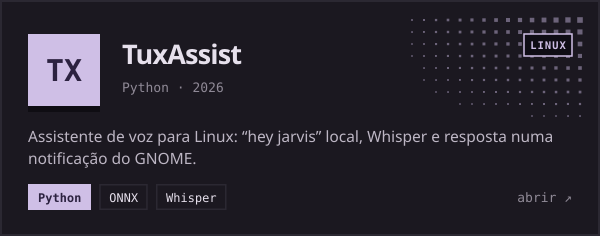</picture></a>
 
<a href="https://github.com/amendoa657/ZeGotinhaGame"><picture><source media="(prefers-color-scheme: dark)" srcset="assets/projetos/ze-gotinha-escuro.svg"><source media="(prefers-color-scheme: light)" srcset="assets/projetos/ze-gotinha-claro.svg">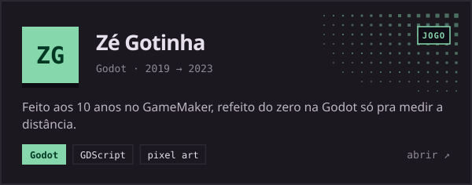</picture></a>
<a href="https://github.com/amendoa657/RaycastingGame"><picture><source media="(prefers-color-scheme: dark)" srcset="assets/projetos/raycasting-escuro.svg"><source media="(prefers-color-scheme: light)" srcset="assets/projetos/raycasting-claro.svg">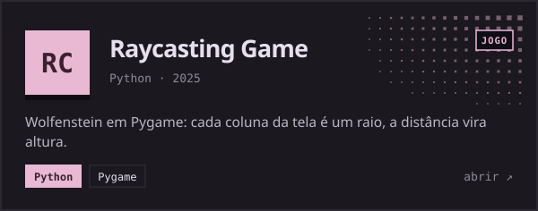</picture></a>
 
<a href="https://github.com/amendoa657/Criptografia"><picture><source media="(prefers-color-scheme: dark)" srcset="assets/projetos/criptografia-escuro.svg"><source media="(prefers-color-scheme: light)" srcset="assets/projetos/criptografia-claro.svg">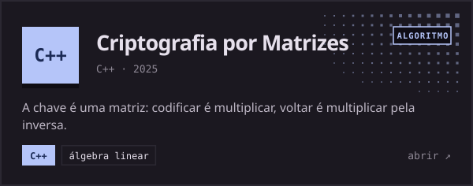</picture></a>
<a href="https://github.com/amendoa657/laravelApiRest"><picture><source media="(prefers-color-scheme: dark)" srcset="assets/projetos/laravel-api-escuro.svg"><source media="(prefers-color-scheme: light)" srcset="assets/projetos/laravel-api-claro.svg">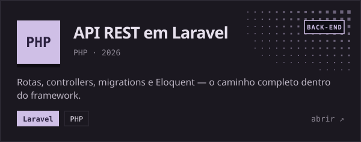</picture></a>

cada quadrado é um repositório — clica pra abrir · <a href="https://github.com/amendoa657?tab=repositories">o resto está aqui</a>

 

## A evolução

<picture>
  <source media="(prefers-color-scheme: dark)" srcset="assets/evolucao-escuro.svg">
  <source media="(prefers-color-scheme: light)" srcset="assets/evolucao-claro.svg">
  
</picture>

 

## Números

  <picture>
    <source media="(prefers-color-scheme: dark)" srcset="https://denvercoder1-github-readme-stats.vercel.app/api/?username=amendoa657&show_icons=true&include_all_commits=true&count_private=true&hide_border=true&border_radius=0&bg_color=0f0d15&title_color=86d7ac&icon_color=e9b9d3&text_color=e6e0ec&ring_color=86d7ac">
    <source media="(prefers-color-scheme: light)" srcset="https://denvercoder1-github-readme-stats.vercel.app/api/?username=amendoa657&show_icons=true&include_all_commits=true&count_private=true&hide_border=true&border_radius=0&bg_color=efebe2&title_color=e5432d&icon_color=2a5bd7&text_color=161513&ring_color=e5432d">
    
  </picture>
  <picture>
    <source media="(prefers-color-scheme: dark)" srcset="https://denvercoder1-github-readme-stats.vercel.app/api/top-langs/?username=amendoa657&langs_count=8&layout=compact&hide_border=true&border_radius=0&bg_color=0f0d15&title_color=86d7ac&icon_color=e9b9d3&text_color=e6e0ec&ring_color=86d7ac">
    <source media="(prefers-color-scheme: light)" srcset="https://denvercoder1-github-readme-stats.vercel.app/api/top-langs/?username=amendoa657&langs_count=8&layout=compact&hide_border=true&border_radius=0&bg_color=efebe2&title_color=e5432d&icon_color=2a5bd7&text_color=161513&ring_color=e5432d">
    
  </picture>

 

feito na estética da Mosaic ✦ os SVGs deste README são gerados por <a href="assets/gerar.py"><code>assets/gerar.py</code></a>

